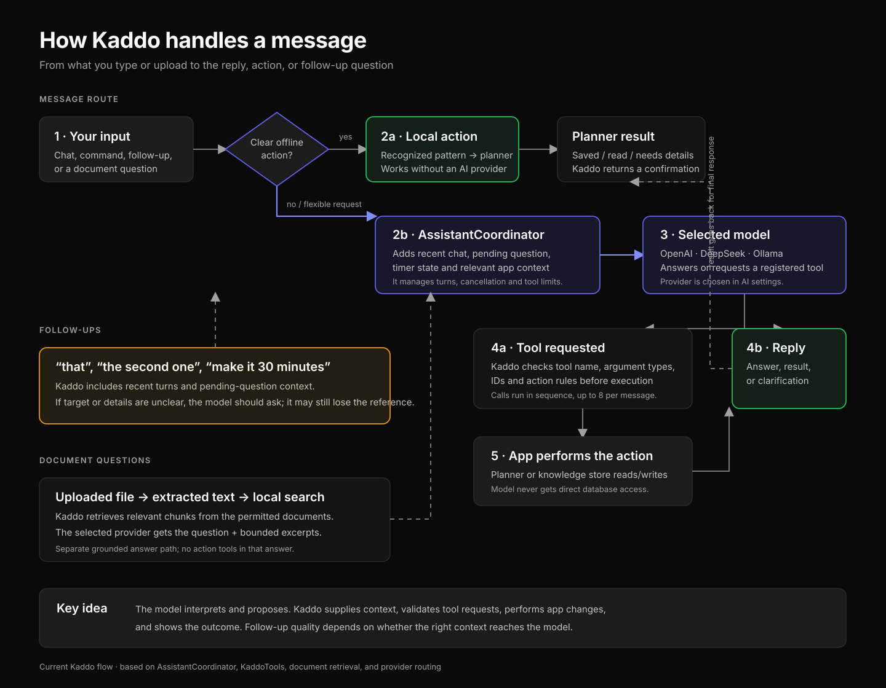

<p align="center"><strong>KADDO</strong><br/>A little company. A clearer study day.</p>

# Your study companion, right on your Mac

Kaddo pairs an animated desktop pet with a natural-language study planner and a local document library. Capture a deadline, find a note, or ask a question about a saved PDF without leaving your desktop.

**Swift 6 · AppKit · SwiftUI · SQLite · macOS 13+**

[Get started](#run-locally) · [Architecture](docs/current-architecture.md) · [Test plan](docs/test-plan.md)

## The experience

| Need | What Kaddo does |
| --- | --- |
| Keep track of study work | Organizes assignments, classes, exams, reminders, and focus timers through chat. |
| Work with your material | Imports PDF, DOCX, TXT, and Markdown; retrieves relevant passages for cited answers. |
| Practice and revise | Manages notes, flashcards, and quizzes alongside the planner. |
| Choose your model | Supports OpenAI, DeepSeek, or local Ollama, with explicit provider selection. |
| Keep a companion nearby | Provides an animated floating pet with native desktop controls. |

## Engineering highlights

- **Native desktop integration:** AppKit window management and SwiftUI interfaces, packaged with Swift Package Manager.
- **Local persistence:** planner data and a SQLite knowledge library live on the Mac; PostgreSQL with pgvector is optional.
- **Document retrieval:** parsing, bounded context selection, local embeddings through Ollama, and source-aware responses.
- **Explicit access boundaries:** the personal agent works with public HTTPS pages and folders the user has approved.
- **Provider transparency:** a failed provider request does not silently switch to another provider.



## Run locally

Requires macOS 13 or later, Swift 6, and Xcode or Xcode Command Line Tools. The first build downloads SwiftPM dependencies.

```sh
git clone https://github.com/MohZak-AI/Kaddo.git
cd Kaddo
./scripts/build-app.sh
open .build/Kaddo.app
```

Choose a provider in **Kaddo → AI settings…**. OpenAI and DeepSeek require your own API key. For local inference, install Ollama and a compatible model separately. Kaddo does not download models automatically.

The development build is ad-hoc signed. A notarized installer is not currently provided.

## Verify

```sh
./scripts/test.sh --filter KaddoCanvasTests
```

The implemented `KaddoCanvasTests` suite is the CI check. `KaddoAcceptanceTests` is a separate specification harness with factories still marked `MVP pending`; an unfiltered test run includes those unfinished checks. Live-provider, pgvector, and desktop-only checks require their opt-in environment settings.

The scripts keep build products and caches in `.build/`. See the [test plan](docs/test-plan.md) and [native acceptance checklist](docs/native-acceptance.md) for coverage and manual checks.

## Data and privacy

Planner data is stored under `~/Library/Application Support/Kaddo/`. The knowledge library is local SQLite. Recent casual conversation is held in memory rather than saved as a chat-history file.

When a cloud model is selected, the user message and relevant bounded context are sent to that provider. Embeddings use local Ollama. See the [knowledge-library guide](docs/knowledge-library.md) for the detailed boundaries.

## Explore the code

| Area | Entry point |
| --- | --- |
| Application | [`Sources/KaddoApp`](Sources/KaddoApp) |
| Companion, planner, and AI services | [`Sources/KaddoCanvas`](Sources/KaddoCanvas) |
| Automated checks | [`Tests`](Tests) |
| Technical documentation | [Architecture](docs/current-architecture.md), [conversation](docs/companion-chat.md), [document ingestion](docs/document-ingestion.md), [personal agent](docs/personal-agent.md) |

## Status and attribution

Kaddo is actively developed. Cloud inference requires provider credentials; local inference requires a running Ollama installation. Autonomous roaming and voice are not included.

No project-wide license has been selected. Bundled character assets retain their own terms: [sprite license](Sources/KaddoCanvas/Resources/SpriteLicense.txt) and [art research and attribution](assets/pet-research/README.md).
