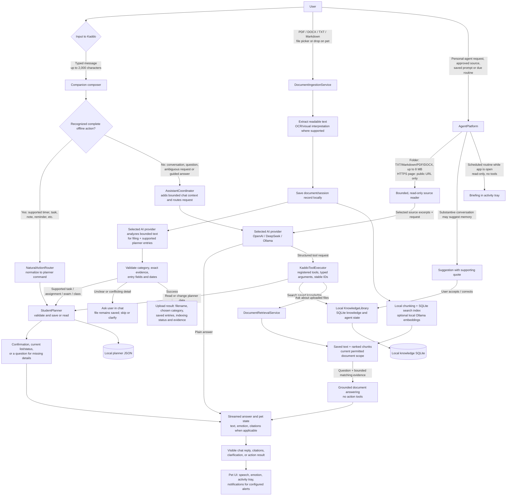

# Kaddo: inputs, processing, and outputs

This flowchart describes the current macOS app behavior and the main input/output
contracts. “Selected AI provider” means the provider chosen in AI settings: OpenAI,
DeepSeek, or local Ollama. Kaddo does not automatically switch providers on failure.

## Input and output quick reference

| Input | What Kaddo does | Output |
| --- | --- | --- |
| Chat text (up to 2,000 characters) | Runs a narrow offline action matcher first; otherwise uses the selected provider with recent conversation context. Tool requests are validated and run sequentially, up to eight per message. | Natural answer, saved/read planner result, clarification, or explicit error. |
| Planner request | Accepts recognized commands for tasks, dates, classes, timers, reminders, notes, flashcards, schedule/profile reads, and related controls. Missing required fields prompt a follow-up. | Confirmation or requested data; persistent planner changes save locally. |
| PDF, DOCX, TXT, or Markdown file | Extracts text, saves it, categorizes it, and detects supported task/deadline/class entries. Indexing and embeddings are local. | Upload summary with destination, planner entries, evidence and index readiness; asks for clarification if needed. |
| Document question | Retrieves ranked excerpts from the relevant documents; explicit filenames narrow the search. Answers receive only bounded evidence and cannot run actions. | Evidence-grounded answer with document citations, or a clear no-match/insufficient-context reply. |
| Personal-agent source request | Reads a public HTTPS page or user-approved folder files using bounded, read-only access. No web search or authenticated browser pages. | Source-grounded answer with source citations; source text is temporary. |
| Scheduled personal-agent routine | Runs a saved prompt against selected sources while Kaddo is open; inference has no tools. | Read-only briefing in the activity tray, or a retryable failure. |
| Memory suggestion | May propose one stable user detail with an exact supporting quote; it does not directly turn source/document content into memory. | User reviews and saves, corrects, or dismisses it. |

## Local and remote boundaries

- Planner records are stored in local JSON. Uploaded text, document indexes, saved
  knowledge, and agent state are in the local SQLite knowledge database.
- Ollama chat and embedding requests run locally. OpenAI and DeepSeek requests go to
  the configured cloud provider. Cloud document answers receive only retrieved excerpts;
  embeddings remain local.
- Personal-agent source reads are separate from general chat. Scheduled routines are
  read-only and cannot create planner entries, save memories, or change settings.
